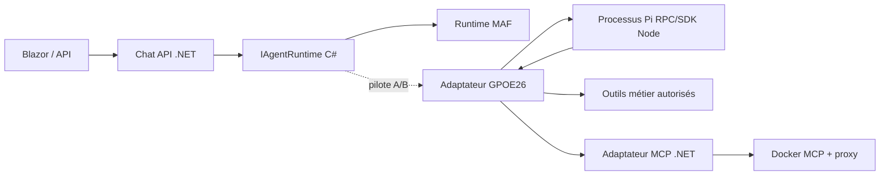

# GPOE26 face au harness Pi

## Identité du projet Pi

Le dépôt actuellement maintenu est
[earendil-works/pi](https://github.com/earendil-works/pi). Sa branche principale décrit le projet
comme un « AI agent toolkit » composé d’un moteur unifié de modèles, d’une boucle d’agent, d’une
interface TUI et d’une CLI de programmation. La licence est MIT.

L’ancien chemin `badlogic/pi-mono` redirige vers `earendil-works/pi`. Pi ne doit donc pas être
considéré comme un fork anonyme : le dépôt `earendil-works/pi` est la source vérifiée en date du
présent document.

Pi fournit notamment :

- `@earendil-works/pi-ai` : abstraction multi-fournisseurs, outils JSON Schema, streaming,
  suivi du coût et authentification ;
- `@earendil-works/pi-agent-core` : boucle d’agent, état, événements, hooks avant/après outil,
  préparation du contexte et poursuite de tour ;
- `@earendil-works/pi-coding-agent` : CLI, sessions, TUI, RPC, extensions, compétences,
  modèles de prompt et packages ;
- `@earendil-works/pi-durable` : runtime durable de conversations, tâches et documents ;
- `@earendil-works/pi-tui` : interface terminal différentielle ;
- `@earendil-works/pi-telemetry` : contrats de télémétrie neutres.

La CLI Pi est orientée vers le travail logiciel et exécute ses extensions avec les droits du processus.
Elle n’inclut pas de système de permissions unifié pour le système de fichiers, les processus,
le réseau ou les identifiants. Elle demande explicitement son isolement dans Docker, un sandbox
géré ou une autre politique de conteneurisation.

## Architecture GPOE26 comparable

GPOE26 utilise déjà des frontières proches de celles d’un harness :

| Couche GPOE26 | Équivalent Pi | Particularité GPOE26 |
|---|---|---|
| `GPOE26.Agent.Abstractions` | SDK Pi agent / types de session | Contrats C# neutres au fournisseur |
| `AgentProfileDefinition` | system prompt, outils et extensions | Profil pédagogique limité à des outils autorisés |
| `MafAgentRuntime` | boucle `pi-agent-core` | Implémentation Microsoft Agent Framework |
| `AgentRunEvent` | événements agent/tour/message/tool | Sérialisable vers l’UI GPOE26 |
| `IAgentToolExecutor` | outils enregistrés dans Pi | Défense hôte : validation et autorisation |
| `ReadOnlyMcpProcessAdapter` | MCP/extensions Pi | Défense plus forte : grant, workspace, Docker, proxy |
| `ObservedAgentRuntime` | télémétrie Pi | OpenTelemetry avec métriques et traces .NET |
| `GPOE26.UI` | TUI ou SDK Pi | Blazor/HTTP, pas de terminal |
| `TutorConversationService` | session/conversation Pi | Historique pédagogique PostgreSQL |
| `WorkspaceContextValidator` | aucune frontière directe Pi | Adhésion et droits par utilisateur/espace |

## Comparaison synthétique

| Critère | GPOE26 actuel | Pi |
|---|---|---|
| Langage principal | C# / ASP.NET / .NET 10 | TypeScript / Node.js |
| Runtime modèle | Microsoft Agent Framework | `pi-ai` + `pi-agent-core` |
| Boucle d’agent | MAF avec repli de modèles | Boucle explicite, hooks et queues |
| Streaming | événements `IAsyncEnumerable` | événements agent/tour/message/tool |
| Multimodèle | listes texte/vision et repli OpenRouter | collection de fournisseurs, OAuth, hand-off |
| Outils | contrats hôte fortement typés | outils JSON Schema enregistrés par extensions |
| MCP | SDK C# officiel, adapter lecture seule | MCP via extensions/serveurs |
| Profil utilisateur | catalogue de profils en mémoire | fichiers, extensions, compétences, templates |
| Sécurité | JWT, workspace, grants, Docker, egress | extensions très puissantes, sandbox extérieur |
| Isolation | serveurs MCP séparés dans Docker | Docker, Docker Sandboxes, OpenShell ou Gondolin |
| Sessions | PostgreSQL par service | fichiers JSONL/format de session, durable SDK |
| Écosystème | microservices .NET/Aspire | monorepo TypeScript/CLI, NPM et Git |
| Personnalisation | code C# à déployer | packages, extensions et ressources locales |
| Adaptation au produit éducatif | directe : profils, cours, quiz, espaces | possible mais doit être redéfinie |

## Ce que Pi fait mieux

- La boucle d’agent est documentée comme primitive autonome, avec hooks de pré/post-exécution,
  continuation de tour, transformations de contexte, queues et événements fins.
- `pi-ai` couvre une très large variété de fournisseurs et ajoute un suivi des coûts, des
  hand-offs inter-modèles et des options de raisonnement.
- L’extension system favorise fortement l’adaptation : outils, commandes, UI, compaction,
  persistance de session et fournisseurs peuvent être ajoutés sans réécrire la CLI.
- Le mode RPC et le SDK permettent d’intégrer Pi dans une application existante ou un autre
  langage.
- Les packages permettent une distribution d’extensions via npm ou Git avec filtres de ressources.

## Ce que GPOE26 fait mieux

- Les autorisations sont liées à l’identité, aux espaces et aux adhésions du produit.
- Le runtime ne reçoit pas les secrets ni les claims d’autorisation comme contexte pédagogique.
- Les outils métier sont appliqués côté serveur avec les contenus réels des cours.
- MCP est soumis à un grant persistant, à des configurations vérifiées et à une sandbox Docker.
- Le réseau MCP dispose d’un réseau interne par scope et d’un proxy egress épinglé.
- Les observations sont intégrées au code C# avec l’écosystème Aspire, OTel et PostgreSQL.

Ces mécanismes ne sont pas des options facultatives de Pi. Ils doivent rester dans GPOE26,
indépendamment du moteur choisi.

## Recommandation

**Ne pas remplacer progressivement tout MAF par Pi dans le même processus ni faire exécuter Pi
directement avec les droits du service Chat.**

Conserver Microsoft Agent Framework au niveau du produit pour l’instant est raisonnable :
GPOE26 est entièrement C# et .NET, tandis que les primitives MAF peuvent être encapsulées derrière
`IAgentRuntime`. C’est cette enveloppe qui protège déjà les API et autorise une implémentation Pi
ultérieure.

Piloter Pi ensuite comme un **runtime pédagogique optionnel isolé**, séparé du service Chat :

Dans cette architecture :

- `Chat` reste propriétaire des conversations, JWT, abonnements et contexte workspace.
- `IAgentRuntime` reste le contrat stable de bout en bout.
- Le processus Node Pi reçoit seulement une demande déjà autorisée, non les credentials GPOE26.
- Pi ne peut appeler directement les API métier : les appels passent par `IAgentToolExecutor`.
- L’adaptateur traduit les événements Pi vers `AgentRunEvent`.
- La sortie Pi reste une donnée non fiable jusqu’au rendu par GPOE26.
- MCP reste le sandbox .NET existant ; les extensions Pi ne devraient pas contourner ses grants.

## Plan d’essai recommandé

1. Créer un petit projet `GPOE26.Agent.Runtime.Pi` ou un sidecar Node séparé.
2. Implémenter Pi seulement derrière `IAgentRuntime`; ne pas modifier les API publiques Chat.
3. Publier dans RPC JSONL les seuls profils éducatifs de lecture, niveau et langue.
4. Autoriser les outils GPOE26 par un manifeste, jamais via les permissions OS de Pi.
5. Comparer MAF et Pi sur le même jeu de conversations : qualité, temps, coût, appels d’outils,
   robustesse aux sorties non fiables et comportement avec pièces jointes.
6. N’activer Pi que sur un profil pilote ou un pourcentage faible d’utilisateurs.
7. Conserver un MAF repli ; mesurer les erreurs, car Pi doit respecter les mêmes codes
   `AgentRunFailed`.
8. Étendre uniquement les capacités validées : tutorat, création de cours assistée, exercices,
   recherche autorisée ou plan d’études.

## Ce qui ne devrait pas être repris

- La structure des répertoires `~/.pi/agent` comme magasin d’identité ou de préférences pédagogiques.
- Les compétences ou extensions comme mécanisme d’autorisation utilisateur.
- Les outils et commandes shell de Pi directement accessibles dans les microservices.
- La CLI de développement comme interface principale des élèves.
- Les API ou secrets du fournisseur exposés à une extension ou au processus Pi.
- Les sessions Pi comme seule source de vérité : PostgreSQL reste canonique pour GPOE26.

## Décision finale

Pi est un excellent candidat comme **runtime alternatif de boucle d’agent**, pas comme remplacement
direct de toute l’application. GPOE26 doit conserver son host C#, son moteur d’autorisation,
sa persistance, ses profils pédagogiques et ses sandboxes.

La meilleure évolution est une architecture hybride pilotable :

> MAF/Pi restent remplaçables derrière `IAgentRuntime`, mais l’identité, les outils, les
> autorisations, les MCP, les données et les événements appartiennent à GPOE26.

## Références

- [Dépôt officiel Pi](https://github.com/earendil-works/pi)
- [Présentation des packages Pi](https://github.com/earendil-works/pi#packages)
- [Documentation du runtime agent Pi](https://raw.githubusercontent.com/earendil-works/pi/main/packages/agent/README.md)
- [Documentation des extensions Pi](https://github.com/earendil-works/pi/blob/main/packages/coding-agent/docs/extensions.md)
- [Mode RPC Pi](https://github.com/earendil-works/pi/blob/main/packages/coding-agent/docs/rpc.md)
- [Packages distribuables Pi](https://github.com/earendil-works/pi/blob/main/packages/coding-agent/docs/packages.md)
- [Isolation et conteneurisation Pi](https://github.com/earendil-works/pi/blob/main/packages/coding-agent/docs/containerization.md)
