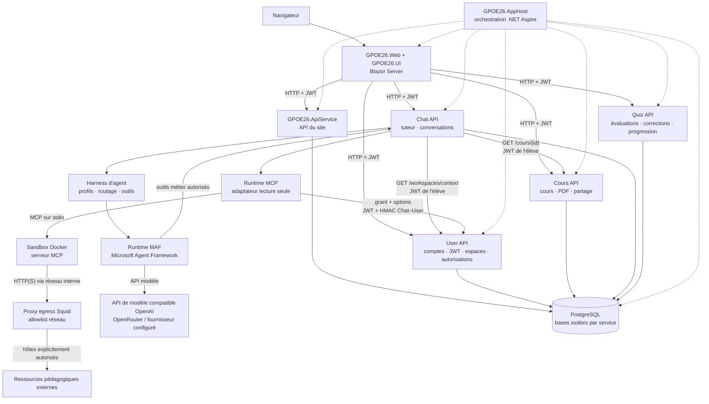
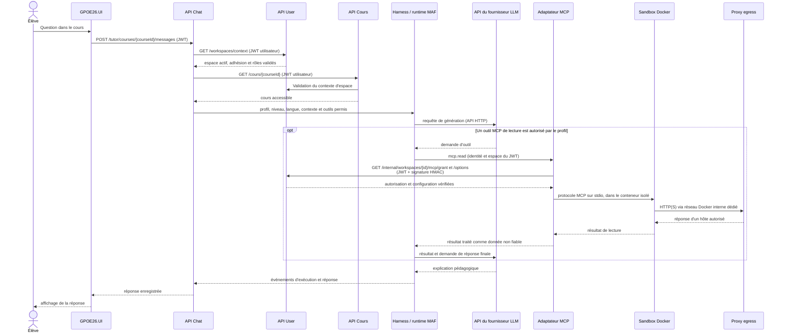

# GPOE26

Plateforme scolaire et d'apprentissage en ligne : site vitrine de l'établissement (actualités, événements, hiérarchie…), cours numériques avec tuteur IA, quiz générés automatiquement, et suivi des élèves par leurs enseignants et leurs parents.

Construite en **.NET 10** : frontend **Blazor Server**, microservices **ASP.NET Core**, base **PostgreSQL**, orchestration locale avec **.NET Aspire**.

---

## Architecture



| Projet | Port | Rôle |
|---|---|---|
| `GPOE26.Web` | 5000 | Interface Blazor Server (site public, espace d'apprentissage, gestion) |
| `GPOE26.ApiService` | 5455 | Actualités, événements, discours, activités, hiérarchie, contacts, upload d'images |
| `User` | 5197 | Inscription, connexion, profil — émet les jetons JWT |
| `Cours` | 5188 | CRUD des cours (sections Markdown ou PDF, extraction du texte via PdfPig), partage avec les classes |
| `Chat` | 5212 | Tuteur IA : discussions conservées par élève et par cours (base `chatdb`), photos d'exercices, résumés, brouillons de cours |
| `Quiz` | 5163 | Évaluations des enseignants (quiz, devoirs, épreuves : base `quizdb`), correction automatique et assistée par IA, suivi de la maîtrise ; génération de quiz par IA |
| `GPOE26.AppHost` | — | Orchestrateur Aspire (PostgreSQL + pgAdmin + tous les services) |
| `GPOE26.ServiceDefaults` | — | Télémétrie, health checks, résilience HTTP partagés |
| `GPOE26.Tests` | — | Tests d'intégration Aspire |
| `GPOE26.Agent.Abstractions` | — | Contrats indépendants du runtime : profils, exécutions, outils, extensions |
| `GPOE26.Agent.Runtime.Maf` | — | Implémentation de `IAgentRuntime` avec Microsoft Agent Framework |
| `GPOE26.Agent.Runtime.Mcp` | — | Adaptateur MCP en lecture seule et lancement par sandbox Docker |
| `GPOE26.Workspaces.Abstractions` | — | Contexte et validation partagés des espaces actifs |

### Flux du tuteur et frontières d'API



Les appels **du navigateur vers les services** sont des API HTTP authentifiées par JWT. Les appels
inter-services vers User transmettent le JWT de l'utilisateur pour revérifier l'identité, l'espace et
l'adhésion ; les services Cours, Chat et Quiz échouent fermés si cette validation est indisponible.
Le pont interne d'autorisation MCP ajoute une signature HMAC courte durée Chat–User. Le runtime appelle
le fournisseur LLM par HTTP ; les serveurs MCP, eux, parlent MCP sur stdio et ne reçoivent pas le JWT.
La base PostgreSQL est partagée comme infrastructure par Aspire, mais chaque service conserve ses
propres données et son contexte. Docker et le proxy egress sont des dépendances opérées séparément,
pas des endpoints publics de l'application.

**Authentification** : JWT (issuer `GPOE2026`, audience `GPOE2026Users`) émis par `User` et validé par `Cours`. Le jeton contient le rôle et le niveau de l'utilisateur, que les services IA utilisent pour adapter leurs réponses.

**Rendu des cours** : Markdown via Markdig, coloration du code avec Prism.js, formules avec KaTeX, table des matières générée automatiquement.

---

## Démarrage

### Prérequis
- [.NET SDK 10](https://dotnet.microsoft.com/download)
- Docker (pour le PostgreSQL lancé par Aspire) **ou** un PostgreSQL existant (Replit)
- Une clé d'API pour le LLM (DeepSeek par défaut)

### Option 1 — Aspire (développement local, Visual Studio)

```bash
cd GPOE26.AppHost
dotnet user-secrets set "Parameters:llm-apikey" "<votre-clé-openrouter>"
dotnet user-secrets set "Parameters:mcp-chat-service-key" "<secret-aléatoire-de-32-octets-minimum>"
dotnet run
```

Le tableau de bord Aspire s'ouvre et démarre PostgreSQL (volume persistant), pgAdmin et tous les services. Dans Visual Studio, définissez simplement `GPOE26.AppHost` comme projet de démarrage.

### Option 2 — Script (Replit ou serveur sans Docker)

```bash
export PGHOST=... PGPORT=5432 PGDATABASE=... PGUSER=... PGPASSWORD=...
export LLM_API_KEY=...   # clé OpenRouter
bash start.sh
```

Le script lance les 5 services backend, attend 30 s, puis démarre le frontend sur le port 5000. Voir `replit.md` pour les détails propres à Replit.

Il démarre en **Production** : aucun compte de démonstration n'est créé. Inscrivez votre compte sur le site, puis relancez avec `ADMIN_EMAILS="vous@exemple.cm"` pour en faire le premier administrateur. Pour une démonstration privée avec les comptes de test : `APP_ENV=Development bash start.sh`.

---

## Configuration

Aucun secret ne doit être commité. Copiez `.env.example` en `.env` (ignoré par git) ou utilisez les *user-secrets* .NET.

| Variable | Service(s) | Description |
|---|---|---|
| `LLM_API_KEY` ou `OPENROUTER_API_KEY` | Chat, Quiz, Cours | Clé OpenRouter (transmise en `LLM__ApiKey`), lue par `start.sh` et par l'AppHost Aspire (à défaut du secret `Parameters:llm-apikey`) ; `DEEPSEEK_API_KEY` reste accepté par `start.sh` |
| `LLM__BaseUrl`, `LLM__Models`, `LLM__VisionModels` | Chat, Quiz | Fournisseur compatible OpenAI (OpenRouter par défaut) et listes de modèles **essayés dans l'ordre** : si un modèle gratuit est saturé (429) ou muet, le suivant prend le relais. Les modèles de vision servent dès qu'une photo est jointe. `LLM__AttemptTimeoutSeconds` (90 par défaut) borne chaque essai ; pour une réponse en continu (tuteur), il borne l'attente du premier mot, puis la réponse a quatre minutes pour se terminer |
| Modèles par défaut | Chat, Quiz, Cours | Gratuits sur OpenRouter (aucun coût) : **Nemotron 3.5 Super VL** en premier, texte et photos — le seul juste et rapide sur toutes les tâches à l'essai du 10 nov. 2026 (tuteur, copie photographiée, correction, quiz, mémoire) ; Nemotron 3 Ultra, Gemma 4 et `openrouter/free` en secours. Inkling 2 Small gratuit n'est pas utilisable : OpenRouter le réserve aux agents de programmation (refus 403). Les modèles gratuits peuvent être saturés aux heures de pointe : le suivant de la liste prend alors le relais |
| `LLM__EmbeddingModel` | Chat | Modèle d'embeddings de la mémoire des agents (recherche par le sens, avec pgvector) et des passages des longs cours donnés au tuteur (table `CourseChunks`, refaite quand le cours change) : `liquid/lfm-2.5-embedding-350m:free` par défaut. Vide : recherche par le texte seulement. Changer de modèle est sans risque : les souvenirs déjà enregistrés avec l'ancien restent trouvés par le texte |
| `LLM__DailyLimitPerUser` | Chat, Quiz | Plafond quotidien de demandes à l'IA par utilisateur et par service (150 par défaut, `0` le désactive), en plus du quota mensuel de la formule. Les demandes servies sont comptées dans la table `AiUsage` ; la lecture d'une copie photographiée pendant une épreuve n'est jamais bloquée |
| `RateLimits__Enabled` | tous les services | `false` désactive les limites de débit (pile de test). Par défaut : 5 mots de passe faux par compte en 15 min, 10 codes refusés en 15 min, 20 demandes à l'IA par minute et par compte ; au-delà, réponse 429 avec un message et `Retry-After` |
| `Services__TimeoutSeconds` | Chat | Délai des appels du tuteur vers Cours, User et Quiz (10 s par défaut) ; un service qui ne répond pas donne 503 et un message, pas un refus d'abonnement |
| `Agents__ReflectionBatch`, `Agents__ReflectionQuietMinutes` | Chat | Mémoire du tuteur consolidée par lots : après 4 questions, ou 10 minutes sans message (un appel au modèle pour plusieurs questions). L'état est en base : rien ne se perd au redémarrage |
| `ConnectionStrings__ChatDB` | Chat | Base des discussions du tuteur (fournie par Aspire) |
| `Jwt__Key` / `Jwt__Issuer` / `Jwt__Audience` | tous les services | Clé de signature JWT (32 caractères au moins). Aucune valeur par défaut hors développement : les services **refusent de démarrer** sans clé, ou avec la clé d'exemple des fichiers `appsettings.Development.json`. Avec Aspire : `dotnet user-secrets set "Parameters:jwt-key" "<clé>" --project GPOE26.AppHost` |
| `Jwt__MaxSessionHours` | User | Durée maximale d'une session prolongée sans ressaisir le mot de passe (12 h par défaut). Le jeton dure 60 min et se renouvelle seul tant que l'utilisateur est actif (`POST /auth/refresh`) |
| `JWT_KEY`, `APP_ENV`, `ADMIN_EMAILS` | `start.sh` | `JWT_KEY` : clé de signature (à défaut, une clé aléatoire est créée dans `.secrets/jwt-key`, hors du dépôt). `APP_ENV` : `Production` par défaut ; `Development` active les comptes de démonstration, le paiement simulé et Swagger — **jamais sur un site public**. `ADMIN_EMAILS` : comptes déjà inscrits à promouvoir administrateurs |
| `ConnectionStrings__UserDB` / `__CoursDB` / `__LyceeDB` | User, Cours, ApiService | Chaînes de connexion PostgreSQL (fournies automatiquement par Aspire) |
| `PGHOST`, `PGPORT`, `PGDATABASE`, `PGUSER`, `PGPASSWORD` | `start.sh` | Utilisées pour construire les chaînes de connexion |

---

## Structure du dépôt

```
GPOE26.slnx                 Solution (serveur, interface, tests ; se construit aussi sous Linux)
GPOE26.Windows.slnx         Application Windows (WinUI) : `dotnet build GPOE26.Windows.slnx`, sous Windows seulement
GPOE26.Windows/             Application Windows : étude hors connexion (SQLite), hôte de GPOE26.UI
GPOE26.AppHost/             Orchestrateur Aspire
GPOE26.ServiceDefaults/     Configuration commune des services
GPOE26.Agent.Abstractions/  Contrats neutres pour les profils, exécutions et outils des agents
GPOE26.Agent.Runtime.Maf/   Adaptateur du runtime Microsoft Agent Framework
GPOE26.UI/                  Espace d'apprentissage (bibliothèque Razor partagée Web / Windows)
GPOE26.Web/                 Frontend Blazor (site + hôte de GPOE26.UI)
  Components/Pages/         Pages (Learning, Cours, Blog, Event, Activity, Hierarchy…)
  Components/UI/            MarkdownViewer, TableOfContents
  Services/                 ApiClient, AuthService
GPOE26.ApiService/          API du site de l'établissement
User/                       Comptes et authentification
Cours/                      Gestion des cours
Chat/                       Tuteur IA (services LLM interchangeables)
Quiz/                       Génération et correction de quiz
GPOE26.Tests/               Tests
scripts/post-merge.sh       Restore + build après un merge (Replit)
start.sh                    Lancement sans Aspire
```

### Extensions du harness d'agents

`GPOE26.Agent.Abstractions` définit un manifeste versionné pour les extensions de type serveur MCP,
skill ou profil, ainsi qu'un registre en mémoire qui valide leur identité, version, provenance,
capacités, paramètres et permissions déclarées. Ce registre décrit des métadonnées uniquement :
un manifeste valide n'installe pas l'extension et n'accorde aucun droit. L'hôte devra appliquer sa
propre politique d'approbation et d'autorisation avant toute connexion ou exécution. Les valeurs
secrètes de configuration ne font pas partie des manifestes.

`GPOE26.Agent.Runtime.Mcp` utilise le SDK C# officiel MCP pour négocier le protocole et découvrir les
outils. L'adaptateur n'accepte que le principal authentifié de la requête, compare son utilisateur et
son espace actif au principal HTTP, revalide l'adhésion auprès de User et interroge un registre de
permissions approuvées par utilisateur et espace à chaque appel. Les outils doivent être déclarés
dans le manifeste, explicitement autorisés, annoncer `readOnlyHint` et avoir un schéma identique à
celui approuvé. Le lancement passe maintenant par `IMcpSandboxClientFactory` ; l'adaptateur ne lance
plus directement une commande sur l'hôte. Sans fournisseur de sandbox configuré, l'exécution échoue
fermée. Les arguments, résultats, timeouts et sessions ont des limites configurées ; les journaux ne
contiennent ni contenu ni secrets.

User persiste les grants par utilisateur, espace et extension. Les endpoints
`POST /workspaces/{workspaceId}/mcp/extensions/{extensionId}/approve` et
`.../revoke` revalident les adhésions et rôles actifs : le propriétaire approuve dans Personal,
un Guardian dans Family, et seul un rôle `Admin` de l'espace Organization (s'il a été attribué)
peut approuver pour cet espace. Le rôle global n'accorde aucun droit workspace. Les options de
processus internes sont protégées par Data Protection en base ; la clé doit rester disponible
après redémarrage et être partagée entre instances. Aucun endpoint public ne permet de configurer
ou lancer un exécutable. Les lectures de grants et d'options utilisées par Chat sont exposées
uniquement sur `/internal/workspaces/{workspaceId}/mcp/{grant|options}` ; elles exigent le JWT
utilisateur avec son espace actif et une signature HMAC Chat–User limitée à la requête et valable
30 secondes. La clé partagée se configure comme paramètre secret Aspire `mcp-chat-service-key`
(configuration injectée `Mcp:ChatServiceKey`), doit contenir au moins 32 octets aléatoires et
n'est jamais transmise dans la requête.

L'ancienne frontière de processus seule **n'était pas un sandbox système** : le serveur MCP conservait
les droits OS du processus hôte. Le fournisseur Docker est maintenant enregistré dans Chat. Il lance
uniquement des images OCI autorisées par configuration et épinglées par digest, sans montage de
fichiers hôte, avec utilisateur non-root, système de fichiers en lecture seule, capacités supprimées,
limites CPU/mémoire/processus et réseau désactivé par défaut. Le runtime refuse le mode `bridge`.
En mode egress, il crée un réseau Docker interne propre au triplet utilisateur/espace/extension,
relie le proxy à ce seul réseau puis y lance le conteneur MCP.
Le proxy Squid limite les méthodes aux lectures Web, les ports à HTTP/HTTPS, les destinations aux
domaines autorisés et bloque les plages IP non publiques. Le jeu d'images autorisées est
vide par défaut : aucune image communautaire n'est exécutée tant que l'opérateur ne l'a pas autorisée.
Docker doit être accessible à l'hôte Chat. Les options de processus persistées utilisent maintenant
une référence d'image, pas une commande ni un chemin d'exécutable hôte.

Pour démarrer le proxy local : `docker compose -f tools/mcp-egress/compose.yaml up -d`.
Il n'expose aucun port sur l'hôte. Le conteneur MCP rejoint seulement le réseau interne ; le proxy
est le seul service également relié au réseau sortant. La configuration initiale autorise
`wikipedia.org`, `openstax.org`, `khanacademy.org`, `research.google`, `www.researchgate.net` et
`www.sciencedirect.com` (avec les sous-domaines de Wikipédia, OpenStax et Khan Academy). Les règles
Squid autorisent des hôtes, pas des chemins : l'URL ResearchGate ne peut donc pas être limitée au seul
chemin `/publication/`. Réviser cette liste avant tout déploiement. Pour une image MCP qui accepte
`HTTP_PROXY`/`HTTPS_PROXY`, configurer `NetworkMode: "egress"` ; le runtime injecte le proxy et
neutralise `NO_PROXY`. Les conteneurs en réseau `none` restent inchangés.
Le proxy garde un réseau sortant séparé, sans port publié. Chaque réseau interne ne contient que le
conteneur MCP concerné et le proxy ; il est étiqueté `gpoe.mcp.sandbox=true`. La révocation ne supprime
pas encore les réseaux inactifs ; l'opérateur peut les lister avec
`docker network ls --filter label=gpoe.mcp.sandbox=true`, puis retirer un réseau précis avec
`docker network rm <nom>` après avoir vérifié qu'aucun MCP ne tourne dessus.

Le tuteur expose un outil générique `mcp.read` uniquement aux profils qui l'autorisent et seulement
avec les cibles retournées par l'adaptateur après vérification des grants et de la configuration.
Chaque lecture revalide l'identité, l'espace et le consentement ; les résultats MCP sont traités comme
des données non fiables. Les manifestes opérateur sont chargés depuis `Mcp:Extensions` dans Chat ;
la liste est vide par défaut. L'interface `/app/mcp` permet de consulter les extensions déclarées et
de gérer les autorisations selon le rôle actif :
soi-même en Personnel, Guardian en Famille, Admin en Organisation. Les listes de membres et de grants
sont limitées à ces règles côté API. Le catalogue et l'allowlist étant vides par défaut, MCP reste
désactivé jusqu'à sa configuration explicite par un administrateur. Les annotations de lecture seule
demeurent une déclaration du serveur, pas une preuve de comportement.
Les images doivent être préchargées par l'opérateur (le runtime utilise `--pull=never`). Le daemon Docker
constitue une frontière de confiance : en production, utiliser un daemon rootless dédié ou une VM isolée.
L'accès au groupe Docker rootful équivaut pratiquement à des privilèges administrateur sur l'hôte.

Les administrateurs disposent des endpoints `/admin/mcp/process-configurations` pour enregistrer, lister,
approuver pour exécution sandboxée ou retirer une configuration MCP. Une configuration est d'abord chiffrée en base avec les états
`IsVerified=false` et `IsSandboxed=false`; elle devient disponible au runtime uniquement après vérification
explicite. Cette approbation ne lance pas l'image : l'image doit aussi figurer exactement dans
`McpSandbox:AllowedImages` et être préchargée. Les références mutables, les variables réservées, les arguments excessifs et les secrets hors
limites sont refusés. La réponse de liste ne contient ni payload chiffré ni secret. Les endpoints restent
réservés au rôle global `Admin`.

Pour le test local, `Chat/appsettings.Development.json` déclare uniquement
`gpoe/mcp-test@sha256:a54841ec3108c3fec04d59c986ffffaf077497f94c56d84679acef3ddf99370d`
comme image sans réseau. L'image est construite depuis `tools/GpoeMcpTestServer/`. Elle expose une
capacité `test_read` en lecture seule, sans réseau ni fichier hôte. La commande Docker reste vide :
l'image utilise son `ENTRYPOINT` .NET pour lancer le serveur MCP stdio.

L'AppHost active le bundle Aspire CLI (`AspireUseCliBundle=true`) pour éviter l'avertissement
`ASPIRE010`. Les tests `WebTests` démarrent l'application distribuée et vérifient les pages `/mcp`,
`/admin/mcp` ainsi que le refus sans JWT des endpoints MCP.

Les fichiers envoyés par les utilisateurs sont enregistrés dans `*/wwwroot/uploads/` et ne sont pas versionnés.

---

## Espace d'apprentissage (`GPOE26.UI`)

L'interface des élèves, enseignants et parents est une **bibliothèque Razor** sans dépendance au serveur ASP.NET : elle est hébergée par `GPOE26.Web` aujourd'hui et le sera par l'application Windows (MAUI Blazor Hybrid) en phase 4.

| Adresse | Écran |
|---|---|
| `/register`, `/login` | Inscription guidée en questions-réponses (élève, enseignant, parent), connexion |
| `/app` | Tableau de bord selon le rôle : plan d'études (élève), mes classes (enseignant), suivi des enfants (parent) |
| `/app/cours`, `/app/cours/{id}` | Cours partagés / mes cours et partage avec les classes ; lecture avec sommaire « Sur cette page » |
| `/app/evaluations` | Évaluations de l'élève, ou épreuves et devoirs de l'enseignant |
| `/app/evaluations/nouvelle`, `…/{id}/modifier` | Éditeur d'épreuve (6 types de questions, paramètres, publication) |
| `/app/evaluations/{id}/composer` | Composition (une question par écran, minuteur, envoi automatique à l'échéance) |
| `/app/evaluations/{id}/copies[/{copie}]` | Copies et correction (proposition de l'IA), ou copie corrigée de l'élève |
| `/app/classes/{id}` | Suivi d'une classe : résultats, maîtrise par cours, élèves à accompagner |
| `/app/abonnement` | Accès Premium, activation d'une clé, souscription, essai |
| `/app/tuteur` | Tuteur IA : toutes les discussions (une par cours) et les explications épinglées |
| `/app/tuteur/{coursId}` | Relecture d'une discussion en pleine page (lisible même sans abonnement) |

- **Architecture** : les pages consomment des interfaces (`IAccountApi`, `IClassroomApi`, `ISpaceApi`, `IFamilyApi`, `ICourseApi`, `IAssessmentApi`, `IProgressApi`, `IAccountApi.WorkspacesAsync`) implémentées en HTTP ; l'application Windows pourra les décorer d'un cache hors ligne.
- **Session** : `SessionState` (une par circuit), persistée par l'hôte via `ISessionStore` — côté Web, dans le `localStorage` du navigateur, chiffrée par la protection des données ASP.NET. Le site fonctionne en un seul circuit interactif sans prérendu (`App.razor`), si bien que la connexion survit à la navigation et au rechargement. Le sélecteur d'espace de la navigation charge les adhésions actives et remplace le JWT après sélection.
- **Fuseau horaire** : les dates sont affichées et saisies dans le fuseau `App:TimeZone` (`Africa/Douala` par défaut), pas celui du serveur.
- **Sécurité** : le Markdown des cours est rendu sans HTML brut (un cours ne peut pas injecter de script chez les élèves).
- **Tuteur IA** (bouton « Demander au tuteur IA » dans le lecteur de cours, tiroir plein écran sur mobile) : chaque question et chaque réponse sont enregistrées (service Chat, base `chatdb`). En rouvrant le cours, l'élève retrouve la discussion ; il peut épingler les explications utiles, joindre la **photo d'un exercice traité sur papier** (le tuteur retranscrit, vérifie la démarche ligne par ligne et donne un indice) ou effacer la discussion. Formules rendues avec KaTeX. Poser une question demande Premium ; relire reste gratuit.
- **Copies sur papier** : pour une réponse ouverte, l'élève photographie sa copie (jusqu'à 4 pages, image réduite dans le navigateur avant l'envoi). L'IA en affiche la lecture pour qu'il la vérifie avant de rendre. L'enseignant voit les photos et peut demander une proposition de note à l'IA, qui lit les images. Une fois les résultats publiés, l'élève peut demander « Analyser ma démarche avec l'IA » (si l'enseignant a activé la correction assistée).
- Les pages historiques du site (`/cours`, `/learning`, blog…) restent disponibles ; la connexion est partagée.

---

## API du service User (comptes)

| Domaine | Endpoints |
|---|---|
| Authentification | `POST /auth/register` (inscription guidée : profil, classes initiales, clé d'abonnement familiale ou individuelle, essai), `POST /auth/login` (e-mail **ou nom d'utilisateur**), `POST /auth/refresh` (prolonger la session), `GET /auth/me`, `PUT /auth/me/profile` (champs selon le rôle), `POST /auth/me/password` |
| Codes personnels | `POST /auth/codes/check` (sans compte : à qui est ce code), `POST /auth/codes/activate` (crée le compte élève ou enseignant ; e-mail facultatif), `POST /access-codes/redeem` (compte existant) |
| Espaces (établissement, enseignant indépendant) | `GET /organizations/mine` ; responsable et gestionnaires : `GET /organizations/{id}` (tableau de bord), `…/members`, `…/teachers`, `…/managers` (responsable seulement), `…/years`, `…/classes` et `…/classes/{cid}/teachers` (affectation par matière), `…/students` (liste, `…/import` CSV avec aperçu, `…/{sid}/status`), `…/codes` (élève, classe, `…/blank`, `…/teacher`) |
| Classes et groupes | `POST /classrooms` (groupe personnel de l'enseignant), `GET /classrooms/mine?as=learner\|teacher\|all[&include=former]` (avec `myRole`, `mySubjects`, `teachers`, `myPeriods`), `GET /classrooms/{id}`, `GET /classrooms/{id}/members[?include=former]` (périodes, portées partagées), `DELETE /classrooms/{id}`, `DELETE /classrooms/{id}/members/{studentId}` (clôt la période) |
| Historique et partage | `GET /me/history` (classes et espaces actuels et passés, ce que chacun voit), `DELETE` ou `PUT /me/sharing/{organization\|guardian}/{id}/{progress\|weak-points}` (ne plus partager, partager à nouveau ; personne réputée majeure) |
| Espaces de travail (harnais d'agent) | `GET /workspaces/mine`, `GET /workspaces/{id}/membership`, `GET /workspaces/context` (vérification de l'adhésion, des rôles et du rôle global actuels), `POST /workspaces/{id}/select` (nouveau JWT avec `workspace_id`, `workspace_kind` et claims répétés `workspace_role` ; connexion et inscription sélectionnent l'espace personnel par défaut). Cours, Quiz et Chat valident le contexte auprès de User sur chaque route protégée et répondent 503 si User est indisponible. |
| Parents | `POST /parents/children/link` (code de l'élève), `POST /parents/children` (créer le compte de l'enfant), `GET /parents/children`, `DELETE /parents/children/{linkId}` ; côté élève `GET /me/parents`, `POST /me/parents/{linkId}/approve` ou `/reject` |
| Abonnements | `GET /subscriptions/me`, `POST /subscriptions/redeem`, `POST /subscriptions/checkout`, `POST /subscriptions/trial` |
| Administration (droit d'administrateur, vérifié en base à chaque appel) | `GET /admin/users`, `PUT /admin/users/{id}/access` (administrateur, éditeur du site), `GET /admin/subscriptions?status=…` (en attente de paiement par défaut), `POST /admin/subscriptions/{id}/activate`, `POST/GET /admin/organizations`, `POST /admin/organizations/{id}/licenses`, `PUT/DELETE /admin/organizations/{id}/owners` (responsable), `POST /admin/organizations/{id}/owner-code` |

**Établissements et codes personnels** (détail : `docs/PLAN-ETABLISSEMENT.md`) : un établissement a un **responsable** (désigné par l'administration) et des **gestionnaires**. Ils créent les années scolaires et les classes, y affectent les enseignants (un par matière), importent la liste des élèves (matricule, nom, classe) et remettent à chacun un **code personnel** `GP-XXXX-XXXX` à usage unique : en l'activant sur la page « J'ai un code » (`/code`), l'élève crée son compte, sans e-mail s'il n'en a pas, et entre dans sa classe ; une place de licence est alors prise. Un **enseignant indépendant** a le même espace en petit (« Mes élèves et codes », 30 places, matricules générés, codes « en blanc »). Il n'y a plus de code de classe commun ni de clé d'établissement partagée.

**Rôles et droits** : chaque compte a un **rôle** — élève, enseignant ou parent — qui détermine son espace. Deux **droits** peuvent s'y ajouter sans le remplacer : *administrateur* (site, abonnements, licences, accès ; claim `admin` du jeton) et *éditeur du site* (actualités, événements, activités, équipe ; claim `site_editor`). Un enseignant nommé administrateur garde ses classes, ses cours et ses évaluations. Dans l'interface, l'administration se trouve sur `/admin` : « Contenu » pour les éditeurs, « Établissement » et « Plateforme » (abonnements, licences, comptes et accès) pour les administrateurs.

Les autorisations et les actions visibles dans l'application dépendent des rôles de l'espace actif ; le rôle global du compte reste utilisé pour le profil et la personnalisation.

### Tuteur IA (service Chat)

| Endpoint | Rôle |
|---|---|
| `GET /tutor/conversations` | Mes discussions (une par cours), avec aperçu et nombre d'explications épinglées |
| `GET /tutor/courses/{courseId}` | Discussion complète sur un cours |
| `POST /tutor/courses/{courseId}/messages` | Poser une question (Premium), éventuellement avec `imageId` ; le contenu du cours est lu dans le service Cours avec le jeton de l'élève (il n'accède qu'à ses cours) |
| `POST /tutor/courses/{courseId}/messages/stream` | La même question, réponse affichée pendant que le modèle l'écrit. Réponse en NDJSON : `{"type":"start"}`, des `{"type":"delta","text":…}`, puis `{"type":"done","question":…,"answer":…}` ou `{"type":"error","message":…}` (rien n'est alors enregistré ni décompté). C'est la route utilisée par le panneau du tuteur |
| `POST /tutor/images`, `GET /tutor/images/{id}` | Photo d'un exercice (JPEG/PNG/WebP, 6 Mo max), visible de son seul auteur |
| `PUT /tutor/messages/{id}/pin`, `GET /tutor/pinned` | Épingler une explication, liste des explications épinglées |
| `DELETE /tutor/courses/{courseId}` | Effacer la discussion d'un cours (les difficultés notées pour ce cours partent avec elle ; les préférences restent) |
| `GET /agent/memories`, `DELETE /agent/memories`, `GET/PUT /agent/memory-settings` | Ce que les agents retiennent (tuteur et assistant), « Tout oublier », couper la mémoire |
| `POST /teacher-agent/ask`, `GET/DELETE /teacher-agent/conversation` | Assistant enseignant : question (les 12 derniers messages sont relus), conversation conservée, effacement |
| `POST /teacher-agent/compose` | Plan, rédaction ou réécriture dans le ton de l'enseignant ; `courseText` : le cours déjà rédigé, pour continuer sans répéter |

Le tuteur reçoit le profil de l'apprenant (classe, sous-système, filière, examen visé et sa date, matières à renforcer, temps d'étude) et répond en anglais à un élève anglophone. Un cours trop long pour le modèle est réduit à son plan et aux parties les plus proches de la question, et le tuteur en est averti. Il doit dire quand une réponse n'est pas dans le cours.

L'accès aux fonctions d'IA est vérifié auprès du service User (formule et quota), à chaque demande.

### Évaluations (service Quiz) et partage des cours (service Cours)

| Qui | Endpoints |
|---|---|
| Enseignant | `POST /assessments`, `PUT /assessments/{id}` (tant qu'aucun élève n'a composé), `POST /assessments/{id}/publish`, `POST /assessments/{id}/close`, `DELETE /assessments/{id}`, `GET /assessments/{id}/submissions`, `PUT /assessments/{id}/submissions/{sid}/answers/{qid}/grade`, `POST …/ai-suggestion`, `GET /progress/classrooms/{classroomId}` ; Cours : `PUT /cours/{id}/sharing` |
| Lecteur d'un cours | `GET /cours/{id}/feedback` (mon avis « Ce cours vous a-t-il été utile ? » ; l'auteur reçoit aussi les totaux), `PUT /cours/{id}/feedback` (`{"useful": true}`), `DELETE /cours/{id}/feedback` |
| Élève | `GET /assessments/mine`, `POST /assessments/{id}/attempts` (démarrer ou reprendre, avec le brouillon des réponses déjà saisies), `PUT /assessments/{id}/attempts/{sid}/draft` (enregistrer le brouillon pendant la composition), `POST /assessments/{id}/attempts/{sid}/questions/{qid}/photos` (photo de copie, enregistrée tout de suite puis lue par l'IA en arrière-plan), `GET /assessments/{id}/attempts/{sid}/photos` (photos et leur lecture), `DELETE …/attempts/{sid}/photos/{pid}`, `POST /assessments/{id}/submissions/{sid}/answers/{qid}/ai-feedback` (analyse après publication), `POST /assessments/{id}/attempts/{sid}/submit`, `GET /assessments/{id}/submissions/{sid}`, `GET /progress/me` ; Cours : `GET /cours/shared`, `GET /cours/{id}` |
| Parent | `GET /progress/students/{studentId}` (enfant rattaché) |

- **Types de questions** : QCM, choix multiples (tout ou rien), vrai/faux, réponse courte (casse, accents et ponctuation ignorés), numérique (virgule, espaces, unité et tolérance acceptés), réponse ouverte (texte ou photo de copie, corrigée par l'enseignant).
- **Correction assistée** : sur demande, l'IA propose une note (arrondie au quart de point) et un commentaire selon les critères de l'enseignant ; rien n'est appliqué sans sa validation.
- **Heure limite** : la plus proche de l'échéance et de la fin de la durée, plus 2 minutes de marge, imposée par le serveur. Au-delà, ou après la clôture, la copie ne change plus : elle est rendue avec le dernier brouillon enregistré (par la page, à la clôture, ou par un travail de fond pour une copie abandonnée).
- **Publication des résultats** : immédiate pour un entraînement ; sinon après la date limite ou la clôture. La vue élève ne contient jamais les bonnes réponses avant.
- **Suivi** : note de la meilleure tentative ramenée sur 20, moyenne, et maîtrise par cours (points obtenus sur les questions liées au cours).
- Le service Quiz interroge le service User avec le jeton de l'utilisateur (classes, élèves, rattachements) : il a besoin de `Services__User` et de la même configuration `Jwt`.

Le JWT contient désormais `premium` (`true`/`false`) et `plan` : les services Chat et Quiz pourront réserver les fonctions Premium aux abonnés sans interroger la base User.

Tant que le paiement n'est pas branché (phase 5), un abonnement souscrit reste `PendingPayment` jusqu'à ce qu'un administrateur l'active.

**Données de démonstration (environnement Development uniquement)** — mot de passe `Test1234!` :
`admin@gpoe26.cm` (Enseignant + administrateur, responsable du « Lycée de démonstration »), `prof@gpoe26.cm` (Enseignant, professeur principal de la « Terminale C »), `eleve@gpoe26.cm` (Élève de cette classe), `parent@gpoe26.cm` (Parent, rattaché à l'élève), licence du « Lycée de démonstration » (50 places). Pour un nouvel élève de démonstration : « Mon établissement » → « Élèves et codes », puis la page `/code`.

En production, aucun compte administrateur n'est créé automatiquement : inscrivez le compte, puis ajoutez son e-mail à `Admin__Emails` (ou `ADMIN_EMAILS` avec `start.sh`) et redémarrez le service User. Les administrateurs nomment ensuite les autres depuis `/admin/utilisateurs`.
Les anciens comptes de rôle « Admin » sont convertis au démarrage : ils gardent le droit d'administration et deviennent enseignants (rôle modifiable en base).

---

## Historique et visibilité (l'apprenant au centre)

Détail : `docs/PLAN-APPRENANT-AU-CENTRE.md`. **Le départ ne détruit rien** :
- **Appartenances datées.** Quitter une classe (retrait, changement, départ de l'établissement) pose `LeftAt` au lieu de supprimer la ligne, et un retour ouvre une nouvelle période. Un filtre EF ne montre que les périodes en cours. L'historique les lit toutes avec `IgnoreQueryFilters()`.
- **Reprise v5** (`User/Data/UserDataMigrations.cs`). Les fiches déjà parties prennent la date de la reprise, puis une contrainte relie `LeftAt` au statut (`Left`, `Revoked`). La v6 est réservée au lot P4 du plan des publics.
- **Visibilité** (`User/Service/VisibilityRules.cs`, règles pures) :
  - la personne voit tout, toujours ;
  - un espace voit la période où elle était là, jusqu'à `Visibility__RetentionMonths` mois après son départ (12 par défaut) ;
  - les notions fragiles ne sont montrées que pour les membres actuels ;
  - une personne réputée majeure peut retirer sa maîtrise et ses notions fragiles, jamais les résultats des évaluations assignées ;
  - les discussions avec le tuteur ne sont partagées avec personne.
- **Interface.** La page « Mon historique » (`/app/historique`) regroupe classes, espaces et partage. Dans la grille d'une classe, les anciens élèves sont à part, avec des cellules « Hors période ».
- **Retour arrière.** `Visibility__Enabled=false` cache les anciens élèves sans rien changer en base. En dernier recours seulement : `scripts/rollback-v5.sql`, après export et sauvegarde.

## Tests

```bash
dotnet test --project Quiz.Tests/Quiz.Tests.csproj
dotnet test --project GPOE26.Logic.Tests/GPOE26.Logic.Tests.csproj
dotnet test --project User.Tests/User.Tests.csproj   # service User sur une vraie base PostgreSQL (Docker requis)
dotnet test --solution GPOE26.slnx   # tout, y compris le test d'intégration (Docker requis)
```

Le `global.json` choisit le lanceur Microsoft.Testing.Platform, le seul accepté par le SDK .NET 10 et suivants (sans lui, `dotnet test` échoue). Si l'AppHost tourne déjà (Visual Studio, Aspire), ses binaires sont verrouillés : ajoutez `--artifacts-path <dossier>` pour compiler les tests ailleurs.

`GPOE26.Tests` démarre l'AppHost complet (Docker requis) et vérifie que la page d'accueil répond. `Quiz.Tests` contient les tests unitaires de la correction automatique et des brouillons de copie ; `GPOE26.Logic.Tests` ceux des règles des autres services (rôles, droits, quotas d'IA, rendu Markdown, mémoire des agents…). Le script `scripts/test-evaluations.sh` rejoue les parcours de la phase 1 bis (63 vérifications : partage des cours, création et publication, droits d'accès, tentatives, correction manuelle et assistée, publication des résultats, suivi enseignant/élève/parent).

Le script `scripts/ui-e2e.js` (Playwright) rejoue dans un navigateur le parcours complet : inscription d'un enseignant, partage d'un cours, création et publication d'un devoir, inscription d'un élève sur mobile, lecture, composition, correction assistée, clôture, rattachement d'un parent et suivi — `node scripts/ui-e2e.js <dossier-captures>` sur une pile démarrée avec des bases neuves.

Le script `scripts/ui-tutor-e2e.js` rejoue avec un vrai LLM (17 étapes) le tuteur et les copies photographiées : question au tuteur, photo d'exercice analysée, épinglage, discussion retrouvée après fermeture du cours, liste et explications épinglées, composition avec photo transcrite, analyse de la démarche, proposition de note de l'enseignant, version mobile. Préparer les données avec `python3 scripts/seed-tutor-demo.py > ids.json` (cours de physique, exercice, élève Premium), puis `node scripts/ui-tutor-e2e.js <captures> ids.json scripts/fixtures/copie-mruv.jpg scripts/fixtures/copie-chute.jpg`.

Le script `scripts/test-user-api.sh` rejoue les parcours de la phase 1 sur le service User (57 vérifications : inscriptions, clés, places, rôles, rattachements) — voir l'en-tête du script pour le lancer.

---

## Feuille de route

La liste détaillée des validations, décisions et fonctionnalités restantes est tenue dans
[`TRAVAUX_RESTANTS.md`](TRAVAUX_RESTANTS.md).

La comparaison entre l’architecture GPOE26 actuelle et le harness open source Pi est disponible dans
[`COMPARAISON_HARNESS_PI.md`](COMPARAISON_HARNESS_PI.md).

| Phase | Contenu | État |
|---|---|---|
| 0 | Nettoyage du dépôt, secrets hors du code, README | ✅ |
| 1 | ✅ (API) **Comptes et rôles** : Élève, Enseignant, Parent, avec les droits administrateur et éditeur du site ; structures (établissement scolaire, autre institution : entreprise, startup, centre de formation…) ; classes et groupes avec code d'invitation ; lien parent ↔ enfant ; abonnements et **clés d'abonnement** (familiale, établissement/institution) ; plan d'études et progression : à faire | Backend fait, interface en phase 3 |
| 1 bis | ✅ (API) **Évaluations enseignant** : cours, devoirs et épreuves (quiz d'entraînement, devoir, épreuve notée, épreuve blanche) avec questions QCM, choix multiples, vrai/faux, réponse courte, numérique et réponse ouverte (correction manuelle assistée par IA) ; suivi de la maîtrise par élève et par chapitre ; partage des cours avec les classes | Backend fait, interface en phase 3 |
| 2 | **Maquettes** : inscription guidée en questions-réponses (système scolaire camerounais bilingue : classes, séries, BEPC/Probatoire/BAC, GCE O/A Level) ; tableaux de bord par rôle ; lecture de cours à 3 colonnes | À faire |
| 3 | ✅ Intégration Blazor : bibliothèque partagée `GPOE26.UI` (pages, API derrière des interfaces, session persistante), inscription guidée, tableaux de bord élève / enseignant / parent, lecture des cours, composition, éditeur d'épreuve, correction assistée, suivi de classe, abonnement, version mobile ; **tuteur IA avec discussions conservées et explications épinglées, copies photographiées lues par l'IA** (OpenRouter, modèles gratuits avec repli) | Fait (web) |
| 4 | **Application Windows hybride** (.NET MAUI Blazor Hybrid) : lecture des cours et exercices hors connexion (SQLite), synchronisation au retour du réseau | À faire |
| 5 | Paiement des abonnements (Mobile Money / carte) | Plus tard |
| 6 | Import PDF/DOCX/image → Markdown par IA, éditeur de cours à 3 modes, quiz persistés en base, tests | À faire |

**Modèle d'abonnement prévu (freemium)** : les cours partagés par les enseignants restent gratuits ; l'abonnement Premium débloque le tuteur IA, les quiz illimités, les épreuves blanches, le plan d'études et le suivi détaillé.

| Qui | Comment il accède |
|---|---|
| Élève | Gratuit, **ou** clé d'abonnement fournie par un parent ou l'établissement, **ou** abonnement payé lui-même |
| Parent | Paie l'abonnement et reçoit une **clé familiale** à transmettre à ses enfants |
| Enseignant | **Clé de licence** de son établissement ou de son institution (entreprise, startup…), **ou** abonnement enseignant individuel, **ou** essai gratuit |

L'interface est responsive : sur mobile, le menu latéral devient un tiroir (☰) et le sommaire « Sur cette page » se replie en haut de l'article.
